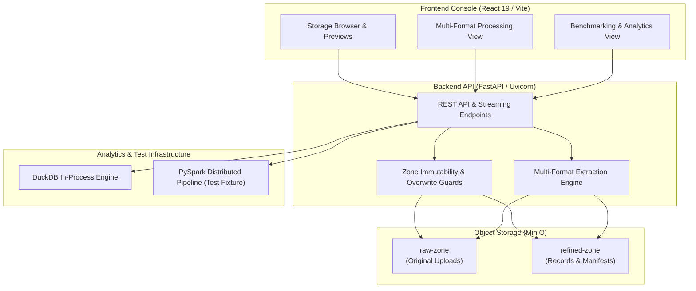

# Nimbus — Local S3-Compatible Cloud Data Lake

Nimbus is a local simulation of an S3-compatible cloud data lake built with **MinIO**, **FastAPI**, and **React**. It implements core data lake tiering between an immutable landing zone (`raw-zone`) and a curated tier (`refined-zone`), providing format-agnostic ingestion across 8 file types, interactive file previews, overwrite safeguards, streaming downloads, single-object deletion, execution duration auditing, and empirical columnar storage benchmarks.

Nimbus runs entirely on local infrastructure using Docker and local network interfaces. It provides a realistic development and evaluation environment for data engineering workflows without requiring cloud credentials or public cloud deployments.

---

## Overview

Nimbus simulates the lifecycle of data ingestion, validation, and transformation within an object-storage architecture:

1. **Ingest:** Upload raw data files directly into `raw-zone`.
2. **Inspect:** Preview file structure, text streams, or metadata in-memory before transformation.
3. **Process:** Extract content and metadata deterministically based on file format.
4. **Curate:** Write structured records and execution manifests to `refined-zone`.
5. **Manage:** Inspect zone contents, download processed artifacts, or delete individual objects.
6. **Benchmark:** Measure processing duration and evaluate columnar storage performance on structured datasets.

Source files in `raw-zone` remain preserved and unmodified during normal processing workflows.

---

## Key Features

- **S3-Compatible Object Storage:** Powered by MinIO Community Edition with bucket-level isolation and standard S3 API semantics.
- **Two-Zone Tiering:**
  - `raw-zone`: Immutable landing zone for original data files.
  - `refined-zone`: Processed storage tier. Direct user uploads are rejected (`HTTP 400`); objects are produced exclusively through verified processing workflows.
- **Multi-Format Extraction:** Native format parsing for **CSV, JSON, XML, TXT, LOG, PDF, JPG, and PNG**, along with in-process **Parquet** inspection via DuckDB.
- **Previews & Execution Manifests:** Interactive in-memory preview cards and standardized execution manifests recording record counts, library availability, source references, and run metadata.
- **Zone Management & CRUD Safeguards:**
  - Collision detection prevents silent overwrites, returning `HTTP 409 Conflict` unless explicit overwrite authorization is supplied.
  - Streaming downloads preserve exact byte contents and original filenames.
  - Single-object deletion with prefix wipe protection (rejects directory-level deletion requests ending in `/`).
- **Execution Duration Auditing:** High-precision operation timing reported for file uploads, preview parsing, extraction routines, and end-to-end processing.
- **Columnar Storage Benchmarking:** Built-in benchmarking engine comparing row-oriented CSV against Snappy-compressed Parquet across multiple repetitions on structured test datasets.

---

## Architecture



### Core Product vs. Demonstration Infrastructure
- **Nimbus Product Core:** Format-agnostic multi-format ingestion, zone CRUD operations, preview drawer, overwrite conflict protection, and execution timing audits.
- **Demonstration & Test Infrastructure:** The PySpark sales transformation pipeline and city-sales DuckDB queries are demonstration test fixtures used to validate local parallel compute execution and columnar query optimization. They run locally using a local Spark session (`local[2]`) against the local S3-compatible MinIO service (not a multi-machine cluster). They are clearly identified in the web console.

---

## Technology Stack

- **Object Storage:** MinIO Community Edition (Docker)
- **Backend Framework:** FastAPI, Uvicorn, Starlette, Pydantic
- **Storage SDK:** MinIO Python SDK
- **Analytical Engines:** DuckDB (in-memory analytics & benchmarks), Apache Spark / PySpark (local parallel execution demonstration via `local[2]` master)
- **Document & Media Libraries:** `pypdf` (PDF text extraction), `Pillow` (image decoding & metadata)
- **Frontend Framework:** React 19, Vite, Vanilla CSS
- **Runtime Environment:** Python 3.12, Java 17 (required for PySpark), Node.js / npm

---

## Project Structure

```text
Nimbus_v1.0.0/
├── backend/                        # FastAPI backend application
│   ├── main.py                     # API routes, CRUD operations, and timing
│   ├── multiformat_service.py      # Format extractors (CSV, JSON, PDF, images, etc.)
│   ├── duckdb_service.py           # DuckDB analytical query service (Demonstration fixture)
│   ├── benchmark.py                # CSV vs Parquet dynamic benchmark engine
│   └── spark_pipeline.py           # PySpark sales transformation pipeline (Demonstration fixture)
├── frontend/                       # React / Vite web application
│   ├── src/                        # Component views, styles, and entry point
│   ├── package.json                # Frontend dependencies
│   └── vite.config.js              # Vite bundler configuration
├── docs/                           # Architecture specifications and phase checkpoints
│   ├── architecture/               # System architecture documentation
│   └── checkpoints/                # Phase 1-4 verification and audit checkpoints
├── samples/input/                  # Generic and demonstration sample input files
├── scripts/                        # Operational scripts (e.g., storage initialization)
├── test-data/                      # Automated test suites and regression fixtures
│   ├── phase2/                     # PySpark pipeline validation tests
│   ├── phase3/                     # DuckDB and benchmark engine tests
│   └── phase4/                     # CRUD, multi-format, and full regression suites
├── compose.yaml                    # Docker Compose configuration for local MinIO
├── test_minio.py                   # Root MinIO connectivity sanity test
├── .gitignore                      # Git exclusion rules
└── README.md                       # Public project documentation
```

---

## Getting Started

### Prerequisites

1. **Docker Desktop & MinIO Image:** Required to run the local MinIO object storage container. The repository's `compose.yaml` references the custom image `nimbus-minio:phase1`, built from pinned MinIO Community Edition source. This image must be available locally in your Docker daemon before starting services; the Compose configuration does not automatically build or download it.
2. **Python 3.12:** Required for the FastAPI backend and test suites.
3. **Node.js (v18+) & npm:** Required for the React/Vite frontend.
4. **Java 17 (OpenJDK):** Required only if executing the PySpark demonstration pipeline.

### General Setup & Launch Workflow

#### 1. Start MinIO Object Storage
Ensure Docker Desktop is running and the `nimbus-minio:phase1` image is present locally, then start the container:
```bash
docker compose up -d
```
Verify that the service is running:
- MinIO S3 API: `http://localhost:9000`
- MinIO Console: `http://localhost:9001`
- Health Endpoint: `http://localhost:9000/minio/health/live`

#### 2. Initialize Storage Zones (Optional)
Run the initialization script to verify that `raw-zone` and `refined-zone` exist and to seed initial demonstration files:
```bash
python scripts/initialize_storage.py
```

#### 3. Start the Backend API Server
Configure environment variables and start the Uvicorn server:
```bash
python -m uvicorn backend.main:app --host 127.0.0.1 --port 8000
```
- API Base URL: `http://localhost:8000`
- Interactive OpenAPI Docs: `http://localhost:8000/docs`

#### 4. Start the Frontend Web Console
In a separate terminal, navigate to the frontend directory, install dependencies, and start the development server:
```bash
cd frontend
npm install
npm run dev
```
- Frontend Web Console: `http://localhost:5173`

---

## Usage

### Storage Management
- **Switch Zones:** Use the zone selector in the Storage Browser to switch between `raw-zone` and `refined-zone`.
- **Upload Objects:** Upload files into `raw-zone`. If a file with the same name already exists, Nimbus requires explicit confirmation before allowing an overwrite. Direct uploads to `refined-zone` are disallowed.
- **Preview Objects:** Click any supported filename to inspect its content in an in-memory preview card.
- **Download Objects:** Use the download action to stream original objects or processed artifacts with their original filenames.
- **Delete Objects:** Remove individual objects with explicit confirmation.

### Distinct Processing Workflows

Nimbus provides two distinct data processing workflows:

#### 1. Generic Multi-Format Workflow
- **Scope:** Format-agnostic file ingestion and record extraction across **CSV, JSON, XML, TXT, LOG, PDF, JPG, and PNG**.
- **Operation:**
  1. Upload original files directly into `raw-zone`.
  2. Inspect structure, text streams, or metadata in-memory via the preview drawer (`GET /api/objects/preview`).
  3. Trigger multi-format processing (`POST /api/processing/multiformat`).
  4. Extracted records and execution manifests are written to `refined-zone/multiformat/<format>/<run_id>/`:
     - `extracted_records.json`: Parsed records, line streams, or image/document metadata.
     - `manifest.json`: Execution metadata, timing, and library status.
- **Data Preservation:** Original source files in `raw-zone` remain preserved and unmodified.
- *Note:* Generic CSV processing extracts structured JSON records into `extracted_records.json`; it does not automatically generate Parquet.

#### 2. Structured-Data Demonstration Workflow
- **Scope:** Distributed data cleaning, Parquet columnar optimization, and DuckDB analytics demonstration.
- **Operation:**
  1. Uses the sales CSV dataset (`sales.csv`) located in `raw-zone`.
  2. Executes the PySpark pipeline in local parallel mode (`local[2]`) via `POST /api/processing/run`.
  3. Produces dual validated outputs under `refined-zone`:
     - Cleaned CSV: `refined-zone/phase2/sales_cleaned/<run_id>/`
     - Snappy-compressed Parquet: `refined-zone/phase3/sales_cleaned/<run_id>/`
  4. Runs interactive in-process SQL queries (e.g., sales by city, high-value orders) against the Parquet dataset using DuckDB via `POST /api/analytics/duckdb`.
  5. Compares CSV and Parquet storage footprint and query performance using the empirical benchmark engine.

---

## Testing & Benchmarking

### Automated Test Suites

#### A. Standalone Unit Tests (No MinIO Required)
These tests validate format extraction using local in-memory fixtures:
```bash
# Multi-format extractor unit tests across 8 formats
python test-data/phase4/test_multiformat_service.py
```

#### B. Integration & Zone CRUD Tests (Requires Local MinIO & Backend)
These tests validate storage operations and REST APIs against running local services:
```bash
# Zone CRUD, overwrite safeguards, and policy rejections
python test-data/phase4/test_zone_crud.py

# Multi-format preview and processing API endpoints
python test-data/phase4/test_multiformat_api.py

# End-to-end immutability, edge cases, and temporary workspace cleanup
python test-data/phase4/test_e2e_final_verification.py

# Benchmark engine multipart handling and rejection logic
python test-data/phase3/test_benchmark_engine.py
```

#### C. Frontend Quality & Build Verification
```bash
cd frontend
npm run lint
npm run build
```

### Benchmarking Prerequisites & Workflow

The empirical benchmarking engine compares row-oriented CSV against columnar Parquet across retrieval latency, scan duration, and query throughput. Benchmark datasets are discovered dynamically based on chronological timestamp order:

1. **Small Production Benchmark (8 Rows):**
   - **Prerequisite:** Requires at least one completed PySpark pipeline run that generated matching CSV parts under `refined-zone/phase2/sales_cleaned/<run_id>/` and Parquet parts under `refined-zone/phase3/sales_cleaned/<run_id>/`.
   - **Execution:** Trigger via the web console (`Evaluation` view) or `POST /api/benchmark/run` with `{"dataset": "small"}`.

2. **High-Volume Synthetic Benchmark (100,000 Rows):**
   - **Prerequisite:** Requires the 100k synthetic dataset fixture. If absent, generate it using the provided script:
     ```bash
     python test-data/phase4/run_phase4_benchmark.py
     ```
     This script deterministically generates 100,000 sales records (`seed=42`), uploads `raw-zone/phase4-tests/sales_100k.csv`, executes the PySpark transformation, writes partitioned CSV and Parquet outputs under `refined-zone/phase4-tests/`, and validates row equivalence.
   - **Execution:** Trigger via the web console (`Evaluation` view) or `POST /api/benchmark/run` with `{"dataset": "100k"}`.

*Note:* Benchmark storage reduction (~62%) and query speedup (up to 21x) results apply to structured tabular datasets. They should not be interpreted as universal performance gains for unstructured media.

---

## Current Limitations

- **Local Simulation:** Nimbus simulates S3-compatible cloud storage on local infrastructure. It does not provision AWS IAM roles, KMS encryption keys, or remote cloud buckets.
- **Local Parallel Execution:** The PySpark demonstration pipeline runs in local mode (`local[2]`) rather than on a multi-machine distributed cluster.
- **Scanned PDF Processing:** Text extraction relies on digital text streams via `pypdf`. Scanned documents containing raster images without an embedded text layer return `status="partial"`; Optical Character Recognition (OCR) is not currently installed.
- **Image Extraction:** Image ingestion catalogs EXIF metadata, dimensions, and color profiles via `Pillow`, but does not perform computer vision transformations.
- **Demonstration Scope:** The PySpark sales transformation pipeline and city-sales DuckDB queries are retained demonstration fixtures for regression testing and do not represent a required Nimbus product schema.

---

## Project Status

- **Phase 1 (Object Storage):** MinIO object storage containerization, bucket isolation, and persistence.
- **Phase 2 (Distributed ETL):** PySpark data cleaning, validation, and CSV output generation in local parallel mode.
- **Phase 3 (Columnar Analytics):** Snappy-compressed Parquet generation and DuckDB in-process analytics.
- **Phase 4 (Benchmarking & Multi-Format):** Empirical benchmarking engine, zone CRUD safeguards, and multi-format extraction across 8 formats.
- **UI/UX Redesign:** Complete. The React 19 web console provides a responsive interface with dedicated Overview, Storage Browser (with zone switching, preview drawer, upload/download/delete modals), Processing (with multi-format and PySpark subnavs), and Evaluation views.
- **Evaluation Error Handling & Reproducibility:** Complete. Dynamic run discovery replaces static run IDs, structured FastAPI error messages are rendered clearly, and both small and 100k benchmark runs are fully reproducible with verified row equivalence.
