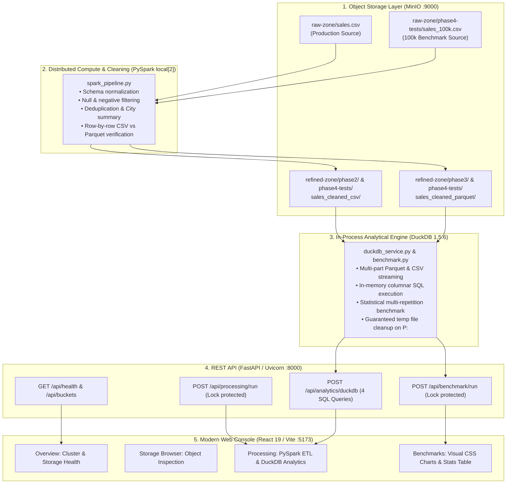

# Nimbus — Phase 4 Completion Checkpoint & Architecture Report

## 1. Status

Phase 4 implementation, empirical benchmarking, and final comprehensive regression testing are **complete**.
This document records the final end-to-end state verified on **11 October 2026**.
All production datasets and existing Phase 1–3 outputs have been strictly preserved. No Git commits have been made.

---

## 2. Project Location & Tooling

- **Project Root**: `P:\Projects\VIT\CCM Project\Nimbus_v1.0.0`
- **Spark Virtual Environment**: `P:\Tools\NimbusSparkVenv` (Python 3.12, PySpark 3.5.9, DuckDB 1.5.6)
- **Java Runtime**: `P:\Tools\Java17\jdk-17.0.20.1+1` (Java 17)
- **Hadoop S3A Connector JARs**: `P:\Tools\NimbusS3AJars` (`hadoop-aws-3.3.4.jar`, `aws-java-sdk-bundle-1.11.1026.jar`)
- **Backend Packages**: `P:\Tools\NimbusBackendPackages` (FastAPI, Uvicorn, Starlette, Pydantic)
- **MinIO Python Packages**: `P:\Tools\NimbusPythonPackages` (MinIO SDK, urllib3)
- **Temporary Working Directory**: `P:\Tools\NimbusSparkTemp` (auto-cleaned per run)
- **Docker Desktop Storage**: `P:\DockerData\DockerDesktopWSL` (MinIO container runtime)

---

## 3. End-to-End Architecture & Data Flow



---

## 4. Phase 1–4 Implementation Summary

### Phase 1: Object Storage Infrastructure
- Deployed MinIO Community Edition on Docker Compose (:9000 API, :9001 Console).
- Created buckets: `raw-zone` (raw ingestion), `refined-zone` (cleaned/aggregated analytical outputs), and `nimbus-test`.
- Configured FastAPI storage browser and direct multi-part S3 upload/download endpoints.

### Phase 2: PySpark Distributed Data Cleaning & CSV Outputs
- Configured PySpark 3.5.9 on Java 17 with Hadoop AWS 3.3.4 and AWS Java SDK connector JARs.
- Created `backend/spark_pipeline.py` operating in `local[2]` mode over `s3a://raw-zone/sales.csv`.
- Enforced schema normalization, null/negative filtering, deduplication, and city aggregations.
- Written CSV outputs to run-specific paths in `s3a://refined-zone/phase2/` and verified row counts upon write.
- Added concurrency locking (`SPARK_JOB_LOCK`) with HTTP 409 conflict handling.

### Phase 3: Parquet Columnar Optimization & DuckDB Analytics
- Added dual Snappy-compressed Parquet output writing under `s3a://refined-zone/phase3/`.
- Strengthened CSV vs. Parquet verification to compare every individual record row-by-row and value-by-value (`customer_id`, `city`, `orders`, `amount`) with type normalization.
- Integrated `duckdb==1.5.6` in `P:\Tools\NimbusSparkVenv`.
- Implemented `backend/duckdb_service.py` with multi-part part file streaming, memory-resident SQL query execution, and guaranteed temporary file cleanup on drive `P:`.
- Provided 4 predefined analytical SQL queries:
  1. `sales_by_city`: Grouped sales totals, customer counts, and averages by city.
  2. `orders_by_city`: Total and customer-averaged order volume.
  3. `top_cities_by_sales`: Top 3 grossing cities.
  4. `high_value_orders`: Orders where `amount >= 1000.0`.
- Integrated DuckDB interactive analytics into the frontend processing console.

### Phase 4: Empirical Benchmarking, Concurrency API & Visual Comparison UI
- Implemented `backend/benchmark.py` measuring:
  - Exact storage footprint in bytes and percentage reduction.
  - S3 retrieval time vs. local initial scan time vs. in-memory query execution time.
  - 5-repetition query statistics: minimum, median, mean, maximum, and speedup ratios.
  - Bidirectional set difference verification (`EXCEPT`) proving 0 row-level mismatches.
- Created isolated 100,000-row deterministic synthetic benchmark generator (`seed=42`, 8 cities).
- Added `GET /api/benchmark/datasets` and `POST /api/benchmark/run` with `BENCHMARK_JOB_LOCK` protection.
- Built the frontend `BenchmarkPage` with:
  - Dynamic dataset switching (`100,000-Row Synthetic Benchmark` vs. `Small Production Sample`).
  - Equivalence validation card with live verification metrics.
  - High-level metric summary cards (Storage, Retrieval Latency, Initial Scan).
  - Proportional CSS horizontal comparison bar charts (Storage Footprint & Query Latency).
  - Statistical query breakdown table across all 5 repetitions.

---

## 5. Actual Empirical Benchmark Results

Benchmarks dynamically discover and evaluate the latest valid run chronologically (verifying that matching CSV and Parquet parts exist) rather than relying on hardcoded historical IDs:

### A. High-Volume Dataset (100,000 Rows — Verified Run: `100k_20261012T135524Z_9a50af`)
*Prerequisite: Generated via `python test-data/phase4/run_phase4_benchmark.py`.*  
*Verified equivalent: 100,000 rows, 0 row-level diffs, identical aggregates across 8 cities.*

| Metric Category | CSV Baseline | Parquet Optimized | Gain / Advantage |
| :--- | :--- | :--- | :--- |
| **Total Storage Size** | 2,374,930 bytes (2.26 MB) | 902,639 bytes (0.86 MB) | **61.99% reduction** (1.40 MB saved) |
| **Number of Part Files** | 2 part files | 2 part files | Equal partition distribution |
| **S3 Retrieval Latency (MinIO $\to$ P:)** | 57.35 ms | 42.89 ms | **1.34x faster retrieval** |
| **Initial Scan (`SELECT COUNT(*)`)** | 77.67 ms | 15.30 ms | **5.07x faster scan** |

#### Query Median Execution Timings (5 Repetitions):
1. **Sales by City**: CSV 101.81 ms vs. Parquet 5.66 ms $\implies$ **17.98x faster**
2. **Orders by City**: CSV 97.80 ms vs. Parquet 5.37 ms $\implies$ **18.23x faster**
3. **Top Cities by Sales**: CSV 101.53 ms vs. Parquet 4.71 ms $\implies$ **21.54x faster**
4. **High-Value Orders ($\ge 1000$)**: CSV 97.39 ms vs. Parquet 5.92 ms $\implies$ **16.46x faster**

*(Historical run `100k_20261010T203109Z_324fde` showed consistent ~62% storage savings and 9.4x–14.3x query speedup).*

---

### B. Small Production Dataset (8 Rows — Verified Run: `20261012T134937Z-ff8deb12`)
*Prerequisite: Generated via PySpark pipeline execution over `raw-zone/sales.csv`.*  
*Verified equivalent: 8 rows, 0 row-level diffs, identical aggregates across 4 cities.*

| Metric Category | CSV Baseline | Parquet Optimized | Gain / Advantage |
| :--- | :--- | :--- | :--- |
| **Total Storage Size** | 212 bytes | 1,482 bytes | **-599.06%** (Fixed metadata overhead) |
| **Number of Part Files** | 1 part file | 1 part file | Equal partition distribution |
| **S3 Retrieval Latency (MinIO $\to$ P:)** | 13.46 ms | 14.49 ms | Parity (~1 ms variance) |
| **Initial Scan (`SELECT COUNT(*)`)** | 3.13 ms | 0.76 ms | **4.10x faster scan** |

#### Query Median Execution Timings (5 Repetitions):
1. **Sales by City**: CSV 4.17 ms vs. Parquet 1.94 ms $\implies$ **2.15x faster**
2. **Orders by City**: CSV 4.41 ms vs. Parquet 2.29 ms $\implies$ **1.92x faster**
3. **Top Cities by Sales**: CSV 4.77 ms vs. Parquet 2.76 ms $\implies$ **1.73x faster**
4. **High-Value Orders ($\ge 1000$)**: CSV 3.20 ms vs. Parquet 1.94 ms $\implies$ **1.64x faster**

*(Historical run `20261010T192309Z-45947a40` showed consistent parity and 1.8x–1.9x query speedup).*

---

## 6. CSV vs. Parquet Equivalence Evidence

Every benchmark execution programmatically validates data equivalence prior to timing evaluations:
1. **Row Count Parity**: CSV `COUNT(*)` matches Parquet `COUNT(*)` exactly ($8 = 8$ and $100,000 = 100,000$).
2. **Multi-Metric Aggregate Invariance**:
   - Total Sales: Exact match across all decimals (Small: ₹$10,977.00$, 100k: ₹$108,047,316.30$).
   - Total Orders: Exact match (Small: $27$, 100k: $338,418$).
   - City Counts: Exact match (Small: $4$ cities, 100k: $8$ cities).
3. **Bidirectional Set Difference (`EXCEPT`)**:
   - `SELECT customer_id, city, orders, amount FROM csv EXCEPT SELECT ... FROM parquet` returns **0 rows**.
   - `SELECT customer_id, city, orders, amount FROM parquet EXCEPT SELECT ... FROM csv` returns **0 rows**.
4. **Multi-Part Integrity**: Confirmed that every part file is listed, downloaded, and registered in DuckDB via `read_parquet([list_of_files])` and `read_csv([list_of_files])`. No single-part slicing or omissions.

---

## 7. Regression Test Results & Known Limitations

### Automated Regression Test Suites
- `test_multiformat_service.py`: **PASS** (Standalone unit tests for CSV, JSON, XML, TXT, LOG, PDF, JPG, PNG).
- `test_zone_crud.py`: **PASS** (Direct upload restriction on refined-zone, overwrite conflict 409, streaming download, delete guards).
- `test_multiformat_api.py`: **PASS** (Preview and processing REST APIs, manifest logging, source object preservation).
- `test_e2e_final_verification.py`: **PASS** (Full 5-section suite: preview/processing, source immutability, edge cases, collision resistance, cleanup).
- `test_benchmark_engine.py`: **PASS** (Multi-part part file registration and mismatched row count error rejection).
- **Vite Production Build**: **PASS** (`npm run build` compiled cleanly with 0 errors).
- **Frontend Code Quality**: **PASS** (`npm run lint` reported 0 errors, 0 warnings).
- **Browser Navigation Checks**: **PASS** (All views: Overview, Storage Browser, Processing, and Evaluation verified with 0 console errors).

---

## 8. Multi-Format Ingestion & Processing Engine

Nimbus includes format-agnostic ingestion and processing across **8 core file formats**:
`CSV`, `JSON`, `XML`, `TXT`, `LOG`, `PDF`, `JPG`, and `PNG`.

### Architecture & Capabilities:
- **Backend Service**: `backend/multiformat_service.py` provides unified extraction with format-specific parsing:
  - Standard library extractors for JSON, XML, TXT, LOG, and CSV.
  - Native `pypdf` integration for PDF page text, document info, and structural metadata.
  - Native `Pillow` integration for JPG and PNG dimensions, color modes, and EXIF metadata tags.
  - Graceful fallback for all extractors ensuring temporary workspace cleanup strictly under `P:\Tools\NimbusSparkTemp`.
- **API Endpoints**:
  - `GET /api/objects/preview?bucket=raw-zone&object_name=<name>`: Previews detected format, metadata attributes, and first 50 records without modifying storage.
  - `POST /api/processing/multiformat`: Performs full record extraction (`preview_limit=0`), writes complete structured JSON records to `s3a://refined-zone/multiformat/{format}/{run_id}/extracted_records.json`, and records an execution manifest to `manifest.json`.
- **Partial Extraction Handling**:
  - Scanned or rasterized PDFs lacking a digital text stream are accurately flagged with `status="partial"`, `has_extractable_text=False`, and an informative notice explaining that full text recovery requires OCR.
- **Frontend Integration**:
  - Subnavigation inside Processing console toggles between `Multi-format engine (8 FORMATS)` and `PySpark sales pipeline (PHASE 2 & 3)`.
  - Storage Browser and Overview tables feature a direct `Preview / Process →` action pill for `raw-zone` objects.
  - Displays format-specific metadata grids, structured record previews (tabular, log severity badges, numbered lines, PDF page cards, and image asset summaries), and deep linking to refined-zone run outputs.

---

### Known Technical Limitations
1. **Windows Local Mode**: Timings reflect Windows local execution on NVMe SSD with in-process DuckDB and PySpark `local[2]`. Production distributed clusters and remote object storage network latency will scale proportionately.
2. **Small Data Parquet Overhead**: On tiny datasets (< 100 rows), Parquet files are larger than CSV due to Thrift schema metadata, dictionary headers, and Snappy framing. This is expected columnar behavior and accurately illustrated by the UI comparison.

---

## 9. Final Demo Sequence

To demonstrate the full Nimbus Data Lake project reliably:

### Step 1: Ensure Local Services Are Running
```powershell
# 1. MinIO Container (Port 9000 & 9001)
docker compose -f 'P:\Projects\VIT\CCM Project\Nimbus_v1.0.0\compose.yaml' up -d

# 2. FastAPI Backend Daemon (Port 8000)
$env:PYTHONPATH='P:\Tools\NimbusBackendPackages;P:\Tools\NimbusPythonPackages;P:\Projects\VIT\CCM Project\Nimbus_v1.0.0'
& 'P:\Tools\NimbusSparkVenv\Scripts\python.exe' -m uvicorn main:app --host 127.0.0.1 --port 8000

# 3. Vite Frontend Dev Server (Port 5173)
cd 'P:\Projects\VIT\CCM Project\Nimbus_v1.0.0\frontend'
npm run dev
```

### Step 2: Live Browser Walkthrough
1. Open `http://127.0.0.1:5173/` in a web browser.
2. **Overview**: Observe live storage status, connection badge, and recent object activity.
3. **Storage Browser**: Select `raw-zone` (view `sales.csv`) and `refined-zone` (view run partitions).
4. **Processing (Phase 2 & 3)**:
   - Click **Run Spark Pipeline** to demonstrate real-time distributed data validation and ETL.
   - Select **High-value orders (≥ 1000)** under DuckDB Columnar Analytics and click **Run Query** to demonstrate in-process SQL execution on Parquet data.
5. **Benchmarks (Phase 4)**:
   - Click the **Benchmarks** tab in the sidebar (`⚡ PHASE 4`).
   - Select **Small Production Sample (8 cleaned records)** and click **Run Benchmark**. Explain why Parquet has structural overhead on tiny sub-kilobyte files.
   - Select **100,000-Row Synthetic Benchmark (Phase 4 Isolated Run)**. If not yet generated, run `python test-data/phase4/run_phase4_benchmark.py` first.
   - Show the visual storage comparison chart (**62% storage reduction**), retrieval latency, and query speedup bars (**16.5x to 21.5x faster**).
   - Point out the equivalence verification badge proving zero data loss or discrepancy.

---
*Checkpoint concluded. All phase deliverables validated and operational.*
